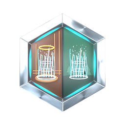

  
  

# JTS - Dashboard Beam

## Mission Directive

Keep a Lovelace dashboard or selected view in sync between two Home Assistant instances. Beam translates prefixed entity IDs, copies supported local images and reports problems in Home Assistant.

## System Registry

| Component | Contract |
| --- | --- |
| Installation | Install Beam on one Home Assistant instance. Both instances must be reachable and run Home Assistant 2026.11 or newer. |
| Scope | One rule connects two editable dashboards, or one view or subview on each side. Views without a path can be selected by position, such as `/0`. |
| Connection | Select an existing Remote Home-Assistant connection to reuse its remote address, credentials and entity prefix. Manual remote setup uses an administrator token. |
| Images | Beam can copy supported local images, including PNG, JPEG and GIF files selected through the Home Assistant media browser. |

## Commissioning

1. In Home Assistant Marketplace, add `Jefferies-Tube-Solutions/dashboard-beam` as a custom integration and install the latest stable release. Restart if prompted.
2. Open **Settings → Devices & services → Add integration → JTS - Dashboard Beam**. Choose the remote connection, source dashboard and scope.
3. Select an existing destination, or enter a name for a new dashboard or view. Beam generates the URL path and creates the destination during the first valid sync.

## Operational Protocol

The first valid sync copies from the selected source. After that, Beam can propagate a change from either side. It checks at startup, after dashboard saves and every five minutes as a fallback. Add a separate rule for each additional dashboard or view pair.

## Verification

Save a small change on one side and check that it appears on the other. If the save event was missed, allow up to five minutes for the fallback check. For a dashboard with a local background image, verify that the image appears on the destination.

## Fault Isolation and Recovery

Beam pauses when an expected entity is missing, both sides have diverged, or a view selected by position can no longer be identified safely. Check the Home Assistant notification for the reason. The **Replication problem** entity can drive an optional badge that appears when the rule is blocked. Follow the human manual to recover the rule or restore a dashboard backup.

## Manuals

- [Human Operations Manual](docs/guides/replication.md)
- [AI Systems Reference](docs/ai/replication.md)

## Operations Log

- [Changelog](CHANGELOG.md)
- [JTS Brand System](https://github.com/Jefferies-Tube-Solutions/jts-brand-system)

The [MIT license](LICENSE) covers software and documentation. [JTS names, logos and other branding](NOTICE.md) are excluded.
